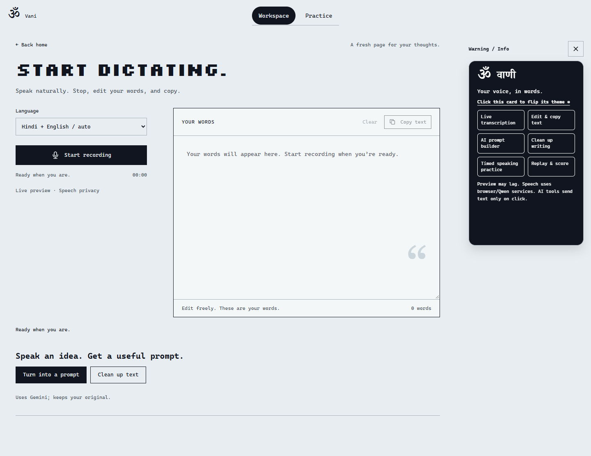
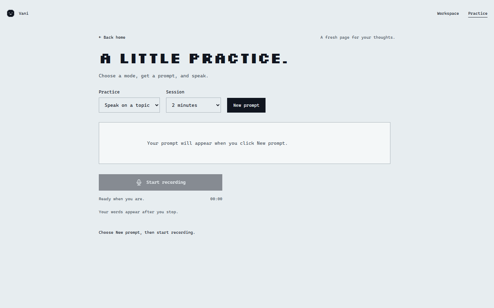
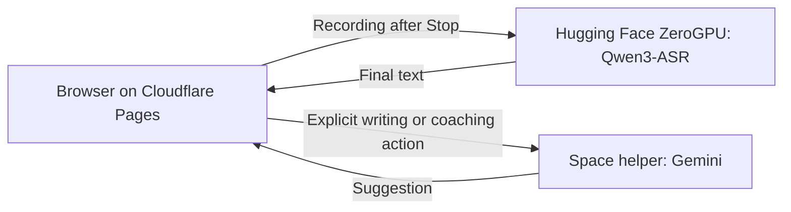

# Vani — वाणी

[](https://github.com/amrit2603/Vani/actions/workflows/ci.yml)

**Your voice, in words.** An open-source Hindi, English and Hinglish dictation app with a separate speaking-practice workspace.

**[Open the live app → vani.amritkumar.dev](https://vani.amritkumar.dev/)**

[Workspace](https://vani.amritkumar.dev/#dictate) · [Practice](https://vani.amritkumar.dev/#practice) · [Speech service](https://huggingface.co/spaces/shubhamsingh123/vani-speech) · [Source](https://github.com/amrit2603/Vani)

The public demo needs no account, installation or model download. It uses shared Hugging Face ZeroGPU inference, so transcription and Practice can temporarily stop when usage/run limits are reached. A custom domain does not remove those limits. This is a working demo project, not an unlimited or always-available speech service.


[Engineering decisions & automated checks](docs/engineering.md)

<details>
<summary>Preview Workspace and Practice</summary>





</details>

## Quick review

- Try [Workspace](https://vani.amritkumar.dev/#dictate) and [Practice](https://vani.amritkumar.dev/#practice), or use the screenshots above if the shared speech service reaches its quota.
- Read [the engineering notes](docs/engineering.md), then follow the local API in [app.py](app.py), bounded inference worker in [engine.py](engine.py) and explicit AI actions in [coaching.py](coaching.py).
- Review [API/audio failure-path tests](tests/test_app.py) and [coaching consent tests](tests/test_coaching.py). Browser preview is provisional; the final ASR result is generated after Stop.

## What you can do

| Area | Features |
| --- | --- |
| Dictation | Choose Hindi, English or mixed-language detection; record, stop, review, edit and copy the transcript. Record again to append text. |
| Live preview | Provisional browser speech text while recording, where supported. Qwen generates the final transcript after Stop. |
| Writing tools | Turn a rough spoken idea into a reusable AI prompt, or clean up repetitions and punctuation. Results stay separate from the original text and can be copied. |
| Practice | Speak on a randomly selected topic or read an authored passage aloud. Choose a 2-, 3- or 5-minute session with countdown and automatic stop. New topics/passages appear only on click. |
| Feedback | Recording duration, estimated recognized words/minute, quiet intervals, a large delivery score with its formula, read-aloud reference agreement and same-topic retry comparison. |
| Coaching | Optional Gemini feedback on what was said, structure, relevance and possible wording issues, with suggestions for the next attempt. |
| Recording review | Listen to your latest recording and download it to keep a copy. Workspace and Practice maintain separate drafts and latest clips while the page is open. |
| Interface | Responsive pale-blue workspace, Om identity, animated penguin with labeled Play/Pause, reduced-motion support and an optional black/white flip feature card. The card appears automatically only once per tab session and can be dismissed or reopened manually. |

## Try it

1. Open [Workspace](https://vani.amritkumar.dev/#dictate), choose a language and press **Start recording**. Allow microphone access.
2. Speak, then press **Stop & transcribe**. Review the result before editing or copying it.
3. Use **Turn into a prompt** or **Clean up text** when useful. Clicking either sends that text to Gemini; the original stays unchanged.
4. For practice, open [Practice](https://vani.amritkumar.dev/#practice), choose a mode/duration, click **New topic** or **New passage**, then record. Review the transcript, playback and feedback, or retry the same topic.

If the demo reaches its free usage limit, save the recording and try later. Failed transcription preserves existing text and offers a manual retry; requests are not automatically retried. Signing into Hugging Face in another tab does not automatically authenticate this anonymous website.

## How it works



- **Frontend:** plain HTML/CSS/JavaScript, with no Node build step. Hosted on Cloudflare Pages at `vani.amritkumar.dev`; the Pages address is [vani-amrit.pages.dev](https://vani-amrit.pages.dev/).
- **Public speech backend:** the project's own [Gradio Space](https://huggingface.co/spaces/shubhamsingh123/vani-speech), using the native Transformers `Qwen/Qwen3-ASR-0.6B-hf` checkpoint on ZeroGPU.
- **Local backend:** FastAPI/Pydantic with the approved `qwen-asr` compatibility runtime and `Qwen/Qwen3-ASR-0.6B`, running on CPU and bound to localhost.
- **Optional AI:** bounded server-side Gemini requests through httpx. Keys belong in local `.env` or Space Secrets, never frontend files.

Hosted live preview uses the browser speech service only; recurring hosted Qwen previews are disabled to conserve GPU runs. Local mode also supports four-second PCM/Qwen preview sections. Neither mode claims native word-by-word Qwen streaming. Preview text can change, lag or be unavailable; browser speech may use its provider and mixed-language support varies.

## Understand the feedback

The **Delivery score / 100** is an experimental rubric: session completion **40**, recognized pace **30** (target 100–180 words/minute), and time outside amplitude-based quiet intervals **30**. At least ten seconds and ten recognized words are required. The UI shows the breakdown and observable suggestions.

Read Aloud also compares recognized words with the passage. Comparable retries use the same topic, mode and duration to show percentage-point and relative score change. They are session comparisons, not a daily progress tracker.

These estimates do not certify speaking ability, pronunciation, confidence, grammar or topic accuracy. Recognition errors, microphone noise and deliberate pauses can affect them. Optional content coaching is an AI suggestion to review, not a verified grade. Speaker labels, pronunciation grading and native streaming are not implemented.

## Run locally on Windows

Install [uv](https://docs.astral.sh/uv/getting-started/installation/), then use PowerShell:

```powershell
git clone https://github.com/amrit2603/Vani.git
cd Vani
powershell -ExecutionPolicy Bypass -File .\setup.ps1
powershell -ExecutionPolicy Bypass -File .\open.ps1
```

After setup, double-click [Open Vani.cmd](Open%20Vani.cmd) to start/reuse the local server and open Workspace. Do not open `static/index.html` directly. For the existing checkout, the launcher is `D:\Vani\Open Vani.cmd`.

Local app: http://127.0.0.1:8787/ · API docs: http://127.0.0.1:8787/api/docs

The first local transcription downloads the model into the user cache unless already present and needs disk space, memory and internet access. CPU inference can be slower than real time; no paid transcription API key is needed. This Windows setup uses Python 3.14; other platforms/versions are not validated. Use one server worker.

The launcher runs a background server, without installing a service or Windows startup task. Use `start.ps1` for a foreground server stopped with Ctrl+C. Startup logs are in `.cache`.

For Gemini, copy [.env.example](.env.example) to `.env` and configure your own `GEMINI_API_KEY` and `GEMINI_MODEL`. The key is optional for speech transcription. Existing request spacing, per-process admission/daily limits and timeouts apply; provider free-tier eligibility and billing depend on your Google project. No automatic AI calls, retries or plan changes are made.

## Privacy and limits

- Recording starts only on **Start recording**. Speech goes to the configured server; browser preview may additionally use the browser provider. AI tools send text/context to Gemini only on click.
- Browser recordings are limited to five minutes / 10 MB and sent as bounded 30-second final-transcription sections. Direct API/Space uploads retain a two-minute / 10 MB limit. Longer recordings need multiple inference calls and consume more shared quota.
- No account system, automatic persistent transcript/audio history, task execution or outbound messaging. Provider logs and temporary upload storage may still exist; this is not a forensic-erasure guarantee.
- Copy or download anything to keep before refreshing/closing. New recordings replace that room's latest clip. A sessionStorage boolean remembers whether the information card was shown.
- Local decoding/inference uses a bounded subprocess deadline and one-inference admission. Canceling a browser request does not instantly terminate an already-started server job. Health checks report liveness, not model readiness.
- **Known upstream dependency advisories remain in the local compatibility runtime.** Do not expose that local API publicly. See [hardening evidence](docs/playbook-hardening.md) and [separate deployment runtime](hosting/requirements.txt); no zero-vulnerability or production-capacity claim is made.
- Hindi may be returned in Devanagari; Romanized Hinglish output and language accuracy are not guaranteed. Om branding does not imply Sanskrit transcription support.

## Deploy and maintain

The frontend is deployed at **https://vani.amritkumar.dev/**. Its public configuration points to `shubhamsingh123/vani-speech`. Use [the deployment guide](docs/free-deployment.md) for Space hardware, Secrets, Pages uploads and subdomain DNS. Existing portfolio records are separate.

To export the current application:

```powershell
.\.venv\Scripts\python.exe prepare_release.py --space shubhamsingh123/vani-speech
```

This creates `dist/web`, `dist/space`, `dist/vani-website.zip` and `dist/vani-space.zip`. Upload only those prepared public files. Generated frontend config targets the Space; local `static/config.json` intentionally stays in local mode. Secrets, caches, user recordings, model weights and environments are excluded from Git/release exports.

## Verification

Public HTML, app script and Space configuration were checked on **18 November 2026**: [deployment check](docs/live-deployment-check.json). A user-supplied hosted Space result confirmed transcription of a 9.24-second recording with 1.544 seconds of model inference; this excludes upload/queue time and is not a latency promise. Anonymous website requests have also hit ZeroGPU limits, so uninterrupted availability is not claimed.

Local evidence includes 28 Python tests, Node metric/score checks, synthetic browser recording/playback/clipboard/error/retry checks, quota handling, hosted-preview suppression, card/session behavior, responsive layouts and actual animation Play/Pause. Browser suites generally mock inference/AI; real-model evidence is labeled separately in [the playbook](docs/playbook-hardening.md). Natural multilingual accuracy, broad hardware/browser compatibility and concurrent-user capacity have not been certified.

```powershell
uv pip install --python .venv/Scripts/python.exe -r requirements-dev.txt
.\.venv\Scripts\python.exe -m unittest discover -s tests -v
node tests/speech-tools.mjs
node tests/score.mjs
node tests/quota-message.mjs
uv tool run --from ruff ruff check .
```

Optional browser checks require a running local server and `npm.cmd install --prefix tmp/qa playwright`. Run `node tests/browser.cjs`, `node tests/overlay.cjs` and `node tests/hosted-quota.cjs`; scripts default to Windows Edge. Full evidence and additional checks are linked in the playbook.

## License and credits

Original application code is [MIT licensed](LICENSE). Model weights, fonts, media and dependencies retain their own licenses and provenance; see [third-party notices](THIRD_PARTY_NOTICES.md). This is an independent project, not affiliated with Wispr Flow or OpenAI Whisper, and separate from NILE Instinct AI's workflows.
