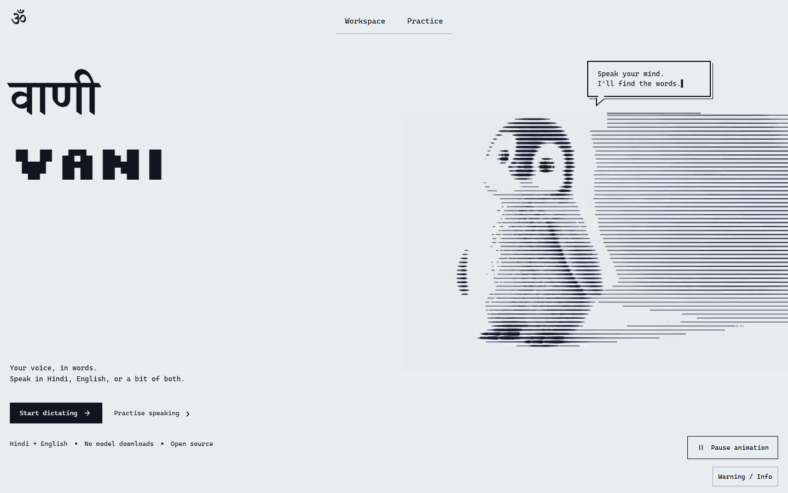

# Vani — वाणी

Standalone local Hindi, English, and Hinglish dictation powered by Qwen3-ASR. MIT-licensed application code; model weights and dependencies retain their own licenses. This is an independent project, not affiliated with Wispr Flow or OpenAI Whisper.

**Your voice, in words.** The video-inspired landing page and recording workspace are implemented: record, stop, transcribe, edit and copy. No visitor installation or model download. The project is independent of NILE's workflows.

**Two simple rooms:** Workspace for dictation, editing and copying. Practice for Speak on a Topic / Read Aloud with 2/3/5-minute sessions, New topic / New passage, a countdown with automatic stop, visible transcript, recording playback/download, concise feedback, same-topic retry and optional Gemini coaching. No setup wizard, batch uploads or advanced tool panels. See [scope, setup and limitations](docs/practice-release.md). The original appearance and animated landing are retained.

**Open on this computer:** double-click **Open Vani.cmd** in D:\Vani. It starts the local server if needed, waits for it to respond, and opens Workspace in your default browser. Keep microphone permission enabled. Do not open static/index.html directly. Startup errors appear in the command window; server logs are in .cache.

The local address is <http://127.0.0.1:8787/#dictate>. Browser-flow checks cover recording, cancellation, clipboard, retries, audio playback/download and mobile layout; actual ASR checks are recorded separately. The intended public site is **vani.amritkumar.dev**, with a separate **shubhamsingh123/vani-speech** ZeroGPU service. These are deployment targets, not claimed live URLs. Follow [the verified free deployment plan](docs/free-deployment.md).



Create upload packages with `.\.venv\Scripts\python.exe prepare_release.py`: `dist/web`, `dist/space`, `dist/vani-website.zip` and `dist/vani-space.zip`. Public speech uses the separate native Transformers runtime in `hosting/requirements.txt`; do not expose the legacy local API publicly. Free hosted inference has queues and daily quotas.

Optional browser checks: `npm.cmd install --prefix tmp/qa playwright`, then `node tests/browser.cjs` and `node tests/simple-ui.cjs` against the running local server. These use a synthetic microphone and mocked ASR replies; see docs for separate real-model results.

Timer/decode boundaries: `node tests/practice-timer.cjs` (accelerated stop timers, verified 120/180/300-second deadlines). Launcher cold-start/reuse: `powershell -ExecutionPolicy Bypass -File tests/launcher.ps1` (requires unused port 8788). Fresh real-model recording, playback and clipboard evidence: [recording-e2e.json](docs/recording-e2e.json).

## Local setup (Windows)

Install [uv](https://docs.astral.sh/uv/getting-started/installation/), then in PowerShell:

```powershell
cd D:\Vani
powershell -ExecutionPolicy Bypass -File .\setup.ps1
powershell -ExecutionPolicy Bypass -File .\open.ps1
```

For a foreground server you can stop with Ctrl+C, run start.ps1 instead. The double-click launcher runs the server in the background; it does not install a service or start on Windows boot.

The server binds only to `127.0.0.1:8787`. API documentation: <http://127.0.0.1:8787/api/docs>. The first transcription downloads Qwen3-ASR-0.6B from Hugging Face into the user's model cache unless already available; allow disk space, RAM, internet access, and extra startup time. Subsequent transcriptions reuse the worker/model. No API key or paid transcription service is needed.

Python 3.14 is used by this Windows setup. Other Python versions/platforms have not been validated. Use one server worker: each additional worker would load another model and bypass the per-process admission limit.

```powershell
curl.exe -F "audio=@sample.wav" -F "language=hi-en" http://127.0.0.1:8787/api/transcribe
```

`language` is `auto` (default), `en`, `hi`, or `hi-en`. Mixed speech uses model auto-detection, without forcing a single language or translating. The model may emit Hindi in Devanagari; Romanized Hinglish output is not guaranteed. Output text is never executed as a command.

## Limits and privacy

- Browser recordings: up to five minutes / 10 MB, split into bounded 30-second requests. Direct API uploads: 10 MB / 120 seconds. One active transcription; concurrent attempts receive 429 with Retry-After.
- Decoding and inference run in a reusable subprocess with a five-minute deadline. A timeout terminates and resets that process.
- Uploaded files are closed and no audio/transcript history is deliberately retained. Multipart uploads may spool to OS temporary storage while being parsed, then are closed; this is not a forensic erasure guarantee.
- Health checks report API liveness, not model readiness. First-request time includes model loading.
- Local host validation, same-origin upload checks, no-store replies, and restrictive browser headers are enabled.
- CPU operation is supported; realtime latency is not promised. This implementation has no GPU mode.

## Development checks

```powershell
uv pip install --python .venv\Scripts\python.exe -r requirements-dev.txt
.\.venv\Scripts\python.exe -m unittest discover -s tests -v
uv tool run --from ruff ruff check .
uv tool run --from pip-audit pip-audit --path .venv/Lib/site-packages
```

See [verification and limitations](docs/playbook-hardening.md), [deployment notes](docs/deployment.md), and [third-party notices](THIRD_PARTY_NOTICES.md). Known upstream ML dependency advisories remain in the **local compatibility runtime**; do not expose that API publicly. The separate native hosting runtime has its own audit and deployment checks.

## Source repository

Published source: [amrit2603/Vani](https://github.com/amrit2603/Vani). This project is separate from NILE. Recordings, model weights, caches, virtual environments and secrets stay out of Git. The supplied penguin animation is an intentional application asset with separate provenance, not a user voice recording. Public source publication does not mean the hosted website or inference service has been deployed.

## Live text, compact interface and deployment

Recording automatically starts live text; there is no separate Live checkbox. Microphone access still starts only after Start recording. Browser speech gives provisional updates when available. Otherwise an AudioWorklet captures four-second mono sections at 16 kHz and sends them to the configured Qwen service, one at a time. When processing falls behind, only three queued preview sections are retained; the full recording is kept for the final pass. Preview gaps, cut words and corrections are possible. Stop waits for an active preview request before the final pass to avoid competing for inference admission. Requests have a 310-second bound; the server retains its own deadline. Cancellation closes capture and discards stale updates but does not instantly terminate an already-running server inference.

This is segmented live preview, not native token-by-token Qwen streaming. A real synthetic English microphone test showed the first Qwen preview before Stop in 7.082 seconds on this machine (docs/live-qwen-evidence.json). This single result is not a speed or multilingual accuracy guarantee. Free shared GPU hosting can queue or exhaust quota, especially with repeated preview calls. Browser speech may use its provider; the Speech privacy link and feature card explain this compactly.

Workspace comes first, followed by Practice, with a moving black navigation indicator. A Vani/penguin feature card appears in both rooms, slides in from the right to a fixed top-right overlay, shows the same features on both faces, flips between black/white themes and stays until closed with X. X dismisses it for the current room; Warning / Info reopens it, and entering the other room shows its card again. The supplied React Bits reference inspired an original vanilla CSS/JS implementation; React and Motion were not added. Language, recording and transcript come first; Turn into a prompt and Clean up text follow the editor and send text to Gemini only on click, retaining the original.

The experimental delivery rubric remains completion 40, recognized pace 30 and quiet-time continuity 30; it is not a certified communication or pronunciation grade. Comparable retries show percentage-point and relative change, not daily progress. Optional AI coaching discusses content and possible wording issues.

Deployment walkthrough: [free-deployment.md](docs/free-deployment.md). Build packages with .venv/Scripts/python.exe prepare_release.py, deploy dist/space to your own ZeroGPU Space, deploy dist/web to Cloudflare Pages, then associate vani.amritkumar.dev and add its CNAME at your DNS provider. No public deployment is claimed yet.

Checks: node tests/interface.cjs, node tests/live-fallback.cjs, node tests/features.cjs, node tests/score.mjs plus the baseline suites. The default live fallback test uses real microphone capture with mocked inference. The optional VANI_REAL_ASR=1 test uses tmp/demo.wav and real Qwen; recordings stay ignored. Physical microphone, natural Hindi/Hinglish, long-session performance and actual hosted streaming still require verification.

## Current brand and animation

The supplied naming image now informs an Om (ॐ) brand mark in the header, feature card and favicon, rendered using the established Devanagari font. This is a symbol treatment, not a claim of Sanskrit speech recognition. The original pale-blue video palette remains. The landing card is hidden, while Warning / Info remains below Play/Pause and opens Workspace; both faces show features immediately, with a visible flip instruction. No Expand/Shrink controls.

The penguin media retains the supplied animation at 25 fps, with a forward/reverse loop to avoid the abrupt end-to-start cut. Play/Pause has a visible label, changing icon and aria-pressed state synchronized with real media events. Reduced-motion disables autoplay. Browser checks cover both actual pause/time freeze and resumed playback, including a second reduced-motion tab.
