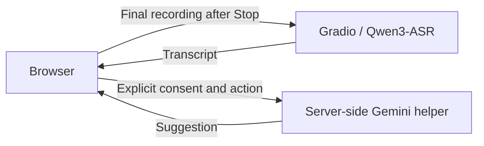

# Engineering notes

## Problem and implementation

Vani turns Hindi, English and mixed-language recordings into editable text, then offers user-triggered prompt building, text cleanup and speaking practice. The frontend is plain HTML/CSS/JavaScript; FastAPI serves the local application. The deployed frontend talks to a Gradio Space for final transcription and optional Gemini text assistance.



## Decisions and tradeoffs

- **Pretrained ASR:** Qwen3-ASR supplies recognition. This project integrates the model; it does not train a new speech model.
- **Live preview versus final result:** supported browsers can show provisional speech text. The recording is transcribed after Stop. Native word-by-word Qwen streaming is not implemented.
- **Bounded work:** upload/duration limits, inference admission and deadlines protect the local process. Hosted quotas still apply; failed requests are not automatically retried.
- **User-controlled AI:** Gemini sees text only after an explicit writing/coaching action. Keys remain server-side.
- **Experimental practice rubric:** the displayed delivery score estimates completion, recognized pace and quiet intervals. It is not a pronunciation or validated communication-skills grade.

## Reproduce the checks

In a fresh Python 3.14 environment, install `requirements-ci.txt` and run:

```sh
python -m unittest discover -s tests -p 'test_*.py' -v
node tests/score.mjs
node tests/speech-tools.mjs
node tests/quota-message.mjs
```

CI mocks inference and Gemini requests. It checks input limits, cross-site rejection, inference failure/deadline handling, consent, secret-file isolation, release exports and frontend scoring/quota logic. It does not establish speech accuracy, GPU capacity, microphone compatibility or public-service uptime. Browser/manual evidence from earlier work is in the other files in this directory; dates and conditions matter.

## Review the demo

Open the [workspace](https://vani.amritkumar.dev/#dictate), record a short non-sensitive clip, stop and edit/copy the transcript. In [Practice](https://vani.amritkumar.dev/#practice), generate a topic, record and review the playback and rubric. If the shared service quota is exhausted, the screenshots in the main README show the interface without claiming the service is currently available.
